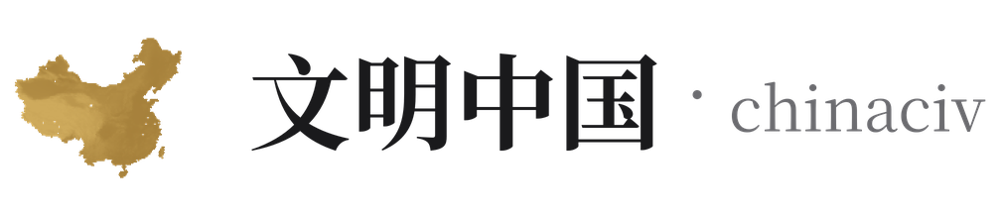
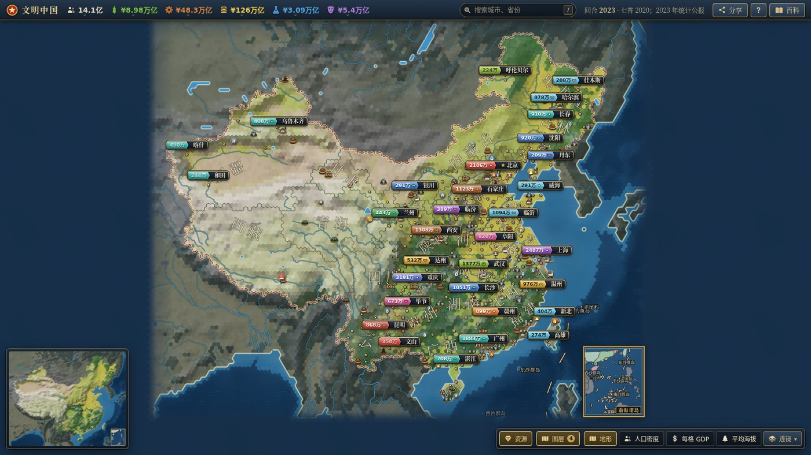
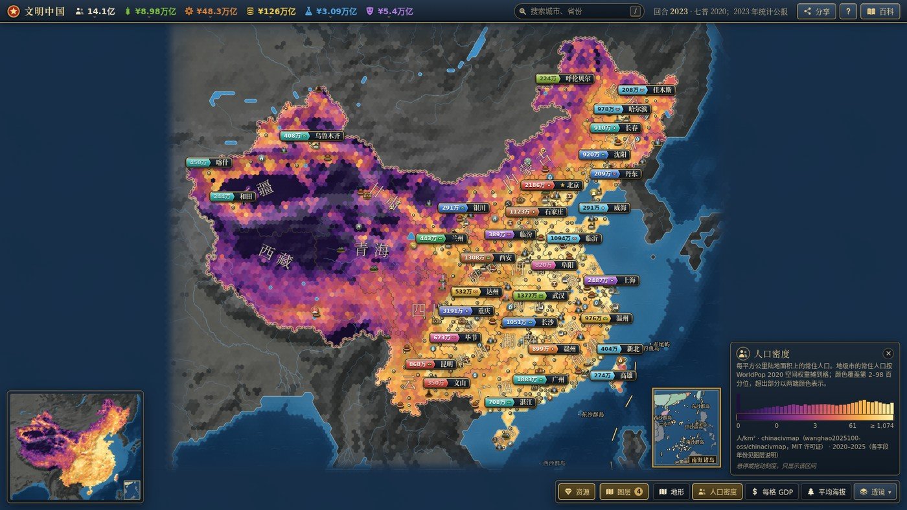
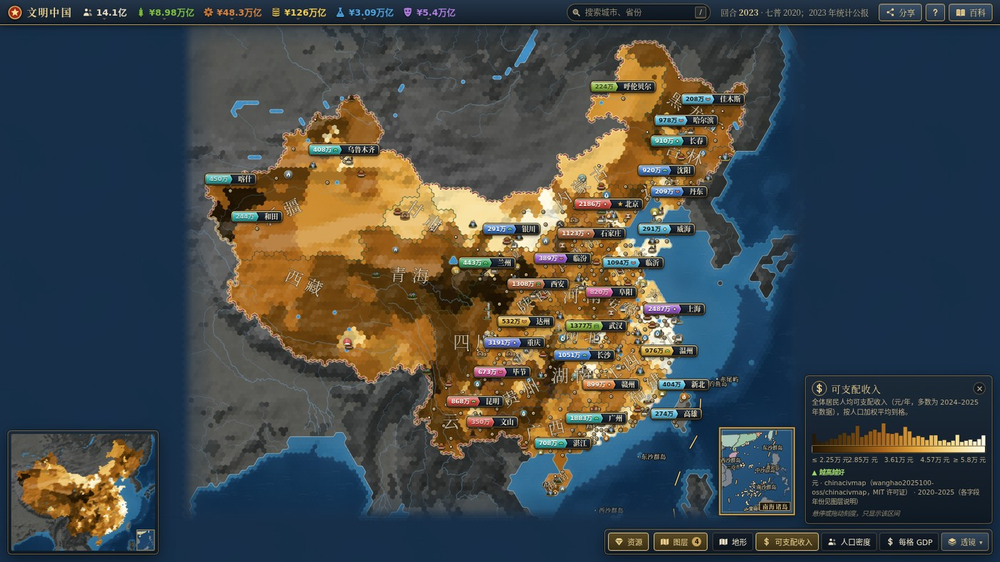
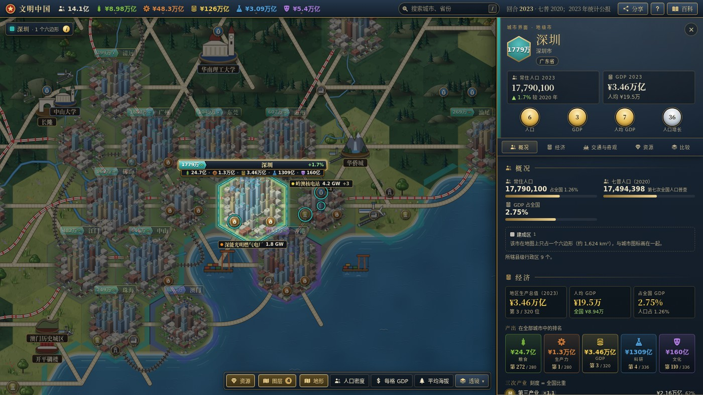
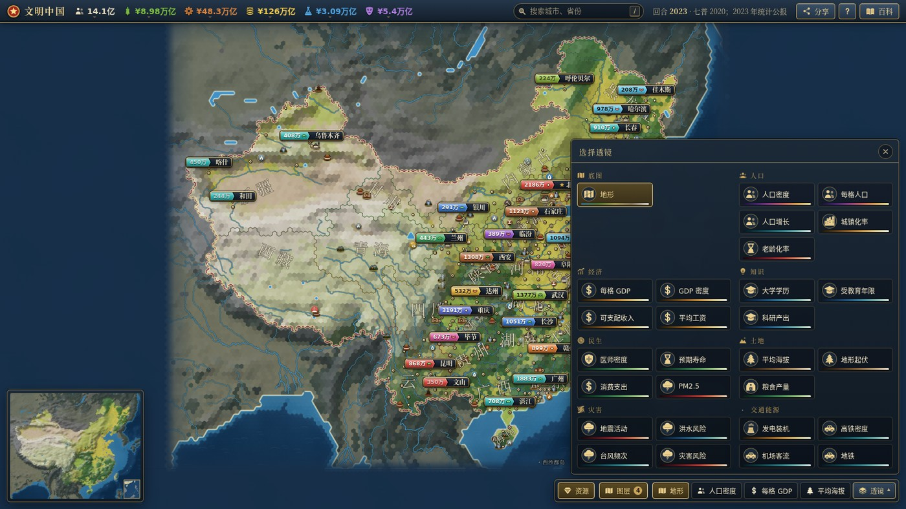
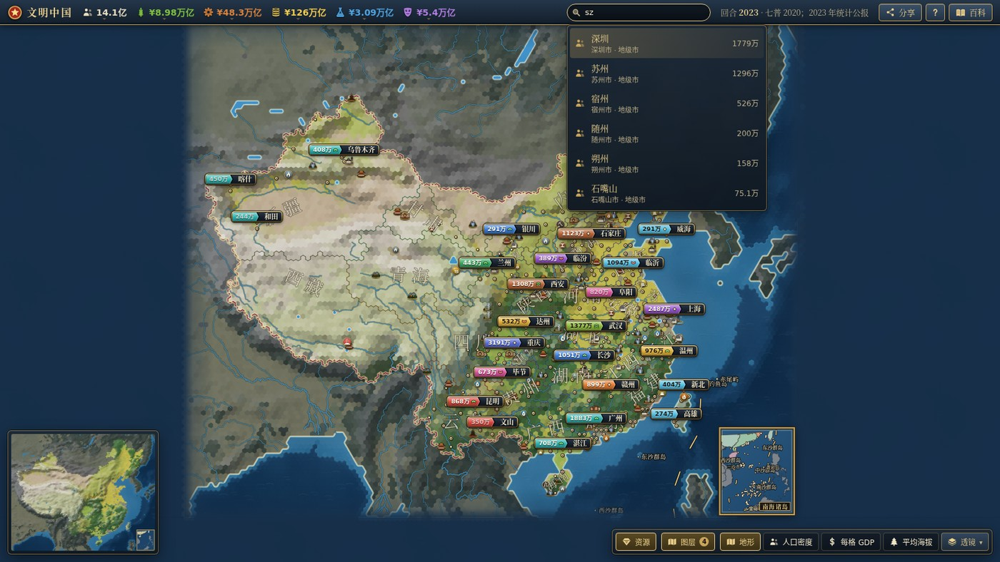
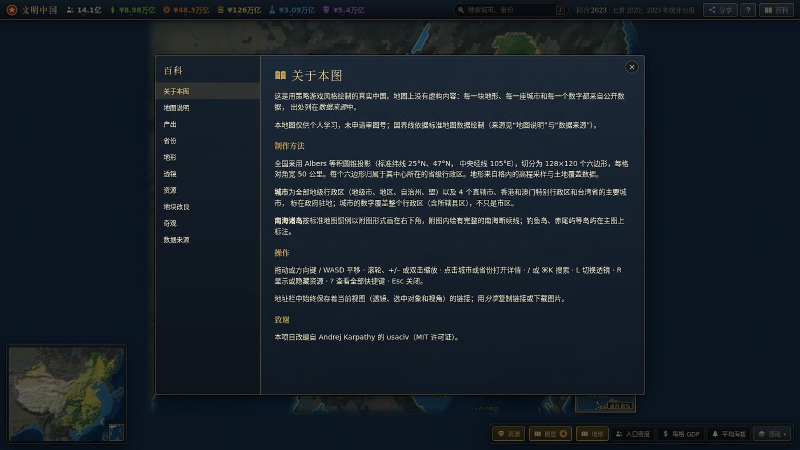

<picture>
  <source media="(prefers-color-scheme: dark)" srcset="docs/images/logo-dark.png">
  
</picture>
The real China, drawn as a Civilization-style map 
Every border, every city, every number comes from public statistics and satellite data
 

**English** · [中文](README.md)
 

 

[Open the live map →](https://china-civilization-map.com)

[**worldciv**](https://world-civilization-map.com) · the whole world as a strategy game · [GitHub](https://github.com/Liuziyu77/worldciv)

## China Civilization Map

Compress 9.6 million square kilometers of mountains, rivers, cities, and economic landscapes into 5,843 hexagonal tiles—each 25 km across.

Here, real-world geography and statistical data are translated into the language of strategy games: every city seat is marked by a banner displaying its population, GDP, and R&D/cultural output; railways, expressways, power plants, and mines sit right at their actual coordinates; and World Heritage sites and top universities appear on the map as "Wonders."

Open the map, and abstract textbook concepts instantly become tangible—you can see at a glance why population density stops east of the Hu Line, how the Yangtze and Pearl River Deltas merge into sprawling megalopolises, and what kind of terrain a railway into Tibet has to cross.

## How to use

**Switch layers.** 27 layers cover population, the economy, education, daily life, land, hazards, and transport
and energy, each with a histogram and a draggable value range.

**Open a city.** The city screen gives population, the three sectors, output rankings, a comparison with peer
cities, and the hex it occupies on the map.

**Read the terrain along rivers and railways.** The plains of the Yangtze, the oases of the Hexi Corridor, the
folds of the Hengduan Mountains — all of it fits into 25 km cells.

**Search.** Looking for a particular place? One keystroke, in Chinese, full pinyin (`shenzhen`) or initials (`sz`).

## Examples

| | | |
|---|---|---|
|  |  |  |
| Population density | Disposable income | City screen · Shenzhen |
|  |  |  |
| Layer picker | Pinyin search | Almanac |

## What's on the map

| | |
|---|---|
| **5,843** land hexagons (25 km, Albers equal-area conic) | **344** city banners: 333 prefecture-level divisions + 4 municipalities + Hong Kong and Macau + 6 cities in Taiwan |
| **2,874** county-level divisions | **34** province-level divisions, including Taiwan, Hong Kong and Macau |
| **3,823** expressway segments, **2,569** railway segments (high-speed rail separate) | **109** airports, **30** ports |
| **523** resource sites: nuclear, hydro, coal, wind and solar, mines, oil and gas fields | **143** wonders: World Heritage, national parks, top scenic areas, leading universities |
| **27** data layers | **220** rivers, **20** lakes |

Five yields: 🌾 Food (primary industry), ⚙️ Production (secondary industry), 💰 Gold (GDP), 🔬 Science (R&D
spending), 🎭 Culture (culture-industry value added).

## Build it together

The data behind this map still contains errors and gaps. Issues and pull requests are very welcome — come
build it with us.

### Contributors

Merged pull requests are added here.

## Credits

The visual language and engine come from [Andrej Karpathy](https://karpathy.ai/)'s
[usaciv](https://karpathy.ai/usaciv). Code is released under [Apache-2.0](LICENSE).
