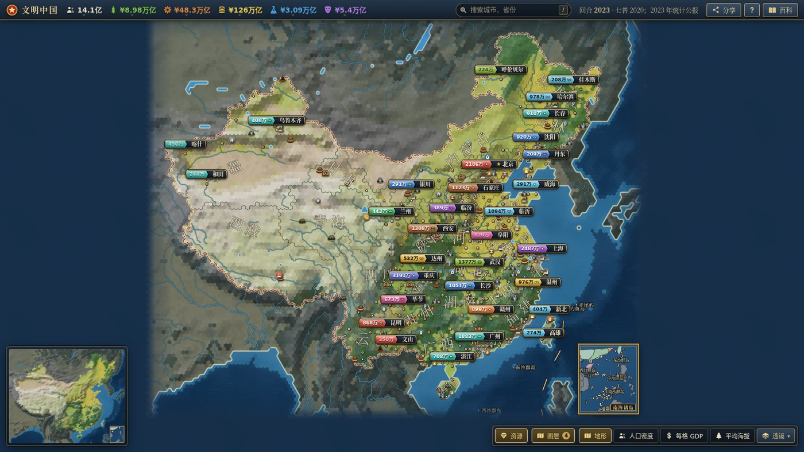
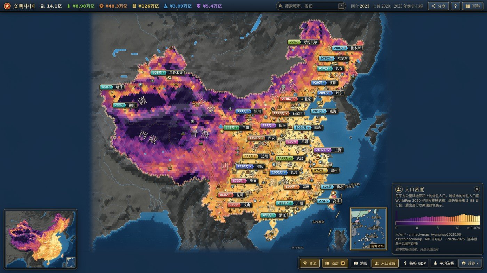
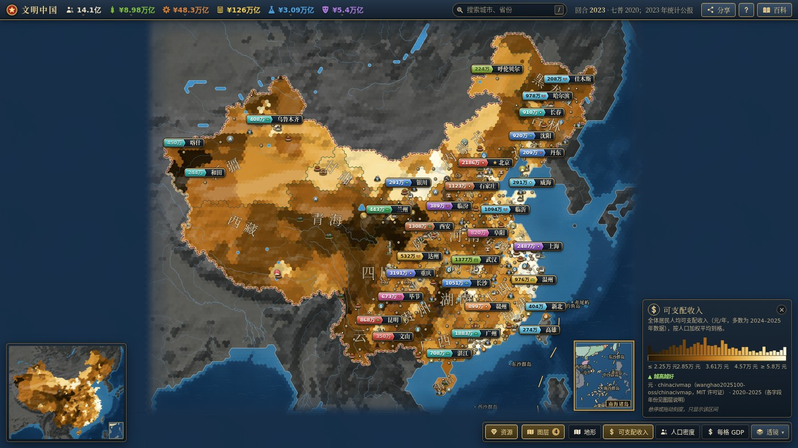
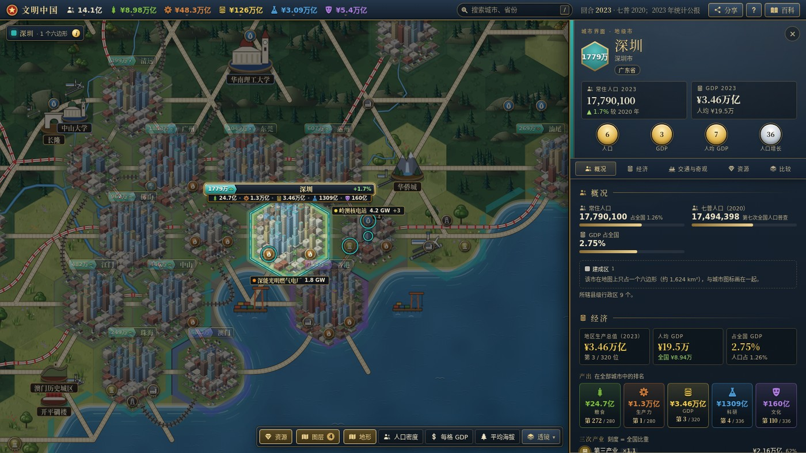
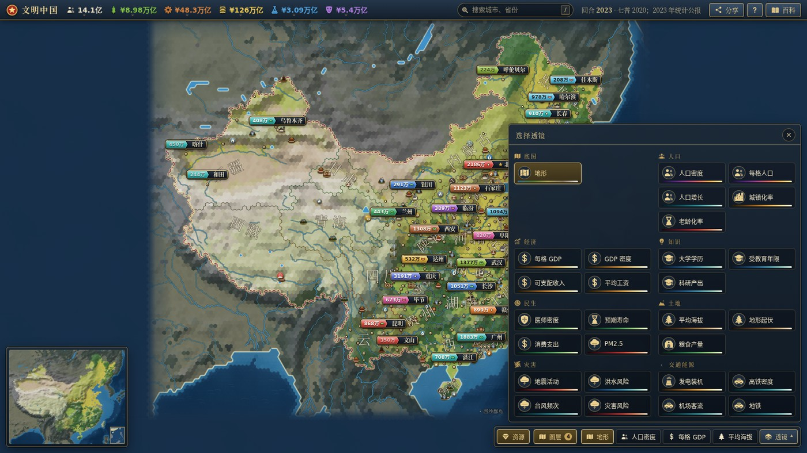
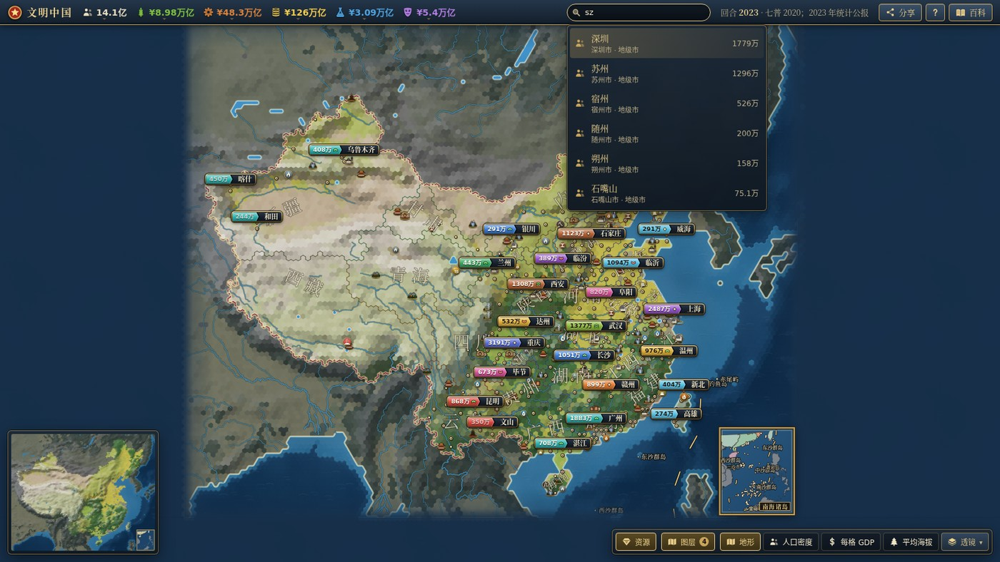
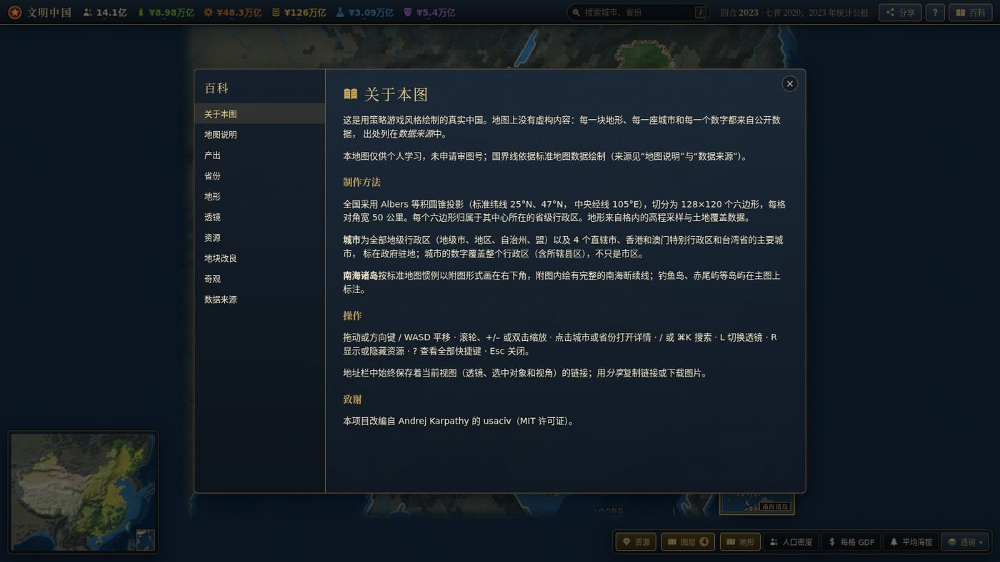

<picture>
  <source media="(prefers-color-scheme: dark)" srcset="docs/images/logo-dark.png">
  
</picture>

把真实的中国，画成一张《文明》地图 
每一条边界、每一座城市、每一个数字，都来自公开统计与卫星数据
 

**中文** · [English](README.en.md)
 

 

[在线体验 →](https://china-civilization-map.com)

[**worldciv**](https://world-civilization-map.com) · 把整个世界画成一张《文明》地图 · [GitHub](https://github.com/Liuziyu77/worldciv)

## 《文明》中国地图

把 960 万平方公里的山川、城市与经济版图，压缩进 5,843 个 25 公里的六边形地块里。

在这里，真实的地理与统计数据被翻译成了策略游戏的语言：每座城市的政府驻地都插着一面旗标，写满了它的人口、GDP 与科研文化产出；铁路、高速、电厂与矿山落在它们真实的坐标上；世界遗产与顶尖高校化作了地图上的“奇观”。

打开地图，那些课本上的抽象概念会瞬间变得直观——你能一眼看清人口为何停在胡焕庸线东侧，看清长三角与珠三角的城市群如何连成一片，也能看清一条进藏铁路要翻越怎样的地形天堑。

## 使用说明

**切换图层。** 27 个图层覆盖人口、经济、知识、民生、土地、灾害与交通能源，自带直方图和可拖动的取值区间。

**城市详情。** 城市界面给出人口、三类产业、产出排名与同类城市对比，以及它在这张地图上所占网格。

**顺着河流和铁路读地形。** 长江沿线的平原、河西走廊的绿洲、横断山的褶皱，在 25 公里的格子里一览山河全貌。

**搜索查找。** 查找你感兴趣的小区域？一键拼音查找。

## 示例

| | | |
|---|---|---|
|  |  |  |
| 人口密度 | 居民可支配收入 | 城市界面 · 深圳 |
|  |  |  |
| 选择图层 | 拼音搜索 | 百科 |

## 地图上有什么

| | |
|---|---|
| **5,843** 个陆地六边形（25 公里边长，Albers 等积圆锥投影） | **344** 面城市旗标：333 个地级行政区 + 4 个直辖市 + 港澳 + 台湾 6 城 |
| **2,874** 个县级行政区 | **34** 个省级行政区，含台湾、香港、澳门 |
| **3,823** 段高速公路、**2,569** 段铁路（高铁单列） | **109** 个机场、**30** 个港口 |
| **523** 处资源站点：核电、水电、煤电、风光、矿山、油气田 | **143** 处奇观：世界遗产、国家公园、5A 景区、一流大学 |
| **27** 个数据图层 | **220** 条河流、**20** 个湖泊 |

产出的五种类型：🌾 粮食（第一产业）、⚙️ 生产力（第二产业）、💰 金币（GDP）、🔬 科研（R&D 经费）、
🎭 文化（文化产业增加值）

## 共建邀请

该地图在数据和准确性上依旧存在错误与误差，欢迎提交 [Issue](https://github.com/Liuziyu77/chinaciv/issues) 和 [PR](https://github.com/Liuziyu77/chinaciv/pulls)，与作者一同共建《文明》中国。

### 贡献者

PR 合并后会出现在这里。

## 致谢

地图视觉语言与引擎来自 [Andrej Karpathy](https://karpathy.ai/) 的 [usaciv](https://karpathy.ai/usaciv)；代码以 [Apache-2.0](LICENSE) 发布。
